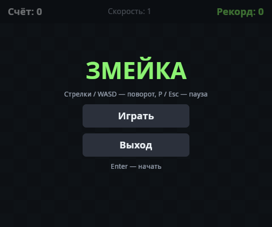
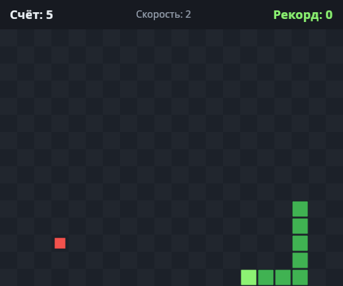
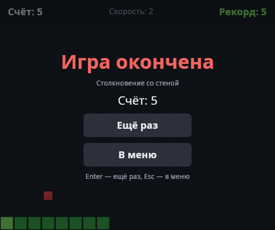
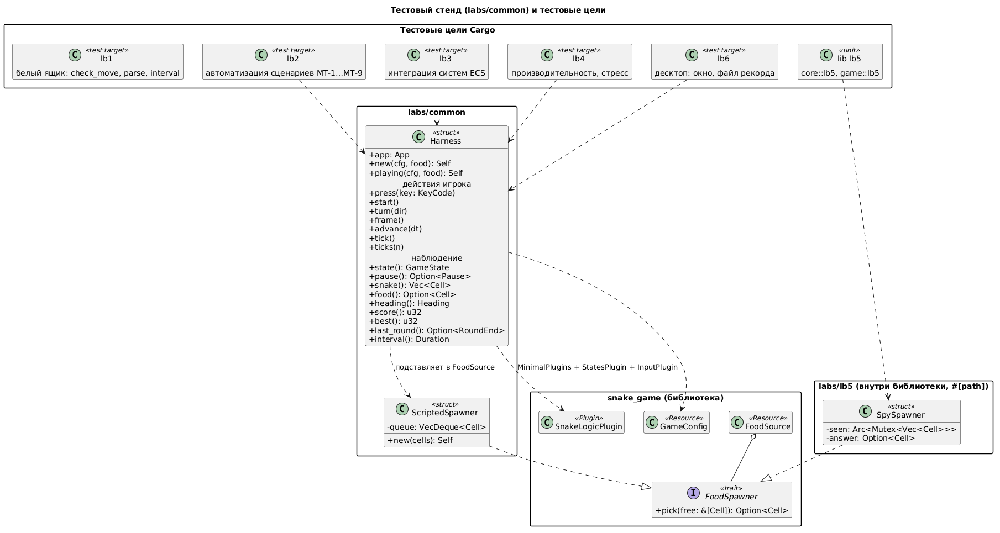

# snake_game

**Имя студента:** Цароев Альберт Казебкович\
**Группа:** ПИЖ-б-о-23-1(1)\
**Предмет:** Тестирование и отладка программного обеспечения\
**Претендую на оценку:** Отлично \
**Индивидуальный вариант:** 10

Змейка на Bevy 0.19 (ECS) и шесть лабораторных работ по тестированию, построенных вокруг неё.
Пакет входит в workspace `bevy_workspace` и использует общий скомпилированный bevy (см. README.md в корне workspace).

## Запуск

```bash
cd snake_game          # запускать из папки пакета: относительно неё ищутся assets/ и best_score.txt
cargo run              # игра
cargo run --example screens   # автоматический обход экранов → снимки в docs/screens/
```

Управление: стрелки или WASD - поворот, P или Esc - пауза, M на паузе - в меню, Enter - начать/ещё раз.
Рекорд сохраняется в `best_score.txt` рядом с пакетом.

| Меню                         | Игра                            | Конец партии                      |
| ---------------------------- | ------------------------------- | --------------------------------- |
|  |  |  |

## Структура

```
snake_game/
├── Cargo.toml            - пакет + тестовые цели lb1…lb6 ([[test]] с path = "labs/lbN/main.rs")
├── src/
│   ├── main.rs           - сборка App: DefaultPlugins + SnakeGamePlugin
│   ├── lib.rs            - библиотека: её видят тесты из labs/
│   ├── core/             - правила без Bevy: поле, повороты, столкновения, еда, скорость, рекорд
│   └── game/             - ECS-слой
│       ├── components.rs, resources.rs, messages.rs, state.rs, config.rs
│       ├── logic.rs      - системы правил (работают без окна)
│       ├── view.rs       - камера, спрайты, клетка → пиксели, параметры окна
│       ├── ui.rs         - HUD, меню, пауза, конец партии
│       └── mod.rs        - плагины SnakeLogicPlugin / SnakeGamePlugin, порядок систем
├── examples/screens.rs   - автопилот + снимки экранов
├── assets/fonts/         - Noto Sans (OFL): встроенный шрифт Bevy не содержит кириллицы
├── labs/                 - лабораторные работы
│   ├── common/mod.rs     - общий тестовый стенд (Harness, ScriptedSpawner)
│   └── lb1 … lb6/        - README.md (отчёт) + тесты работы + results*.txt (протоколы)
├── docs/
│   ├── uml/              - диаграммы PlantUML (.puml) и их рендер (.png, .svg)
│   └── screens/          - снимки экранов
└── scripts/
    ├── test.sh           - запуск тестов работы и запись протокола
    └── uml.sh            - рендер диаграмм через PlantUML-сервер
```

Архитектура: состояние игры живёт в компонентах и ресурсах ECS, решения принимают чистые функции `core`.
`SnakeLogicPlugin` не зависит от окна и рендера, поэтому тесты запускают игру целиком на `MinimalPlugins`.


## Лабораторные работы

| Работа | Тема                        | Выбранный метод                       | Тесты           | Отчёт                                    |
| ------ | --------------------------- | ------------------------------------- | --------------- | ---------------------------------------- |
| ЛР1    | Чёрный и белый ящик         | белый ящик: покрытие ветвей и условий | `labs/lb1/*.rs` | [labs/lb1/README.md](labs/lb1/README.md) |
| ЛР2    | Ручное и автоматизированное | автоматизация ручного чек-листа       | `labs/lb2/*.rs` | [labs/lb2/README.md](labs/lb2/README.md) |
| ЛР3    | Функциональное              | интеграционное (системы ECS)          | `labs/lb3/*.rs` | [labs/lb3/README.md](labs/lb3/README.md) |
| ЛР4    | Нефункциональное            | производительность, нагрузка, стресс  | `labs/lb4/*.rs` | [labs/lb4/README.md](labs/lb4/README.md) |
| ЛР5    | Unit-тестирование           | модульные тесты внутри крейта         | `labs/lb5/*.rs` | [labs/lb5/README.md](labs/lb5/README.md) |
| ЛР6    | По типу приложения          | десктоп-приложение                    | `labs/lb6/*.rs` | [labs/lb6/README.md](labs/lb6/README.md) |

### Как тесты разделены по работам

В Rust два вида тестов, и раскладка по работам использует оба:

- **Интеграционные** - отдельный крейт, видит только публичный API библиотеки. Обычно лежат в `tests/`,
  но Cargo позволяет указать любой путь. Каждая работа объявлена в `Cargo.toml` отдельной целью:
  ```toml
  [[test]]
  name = "lb1"
  path = "labs/lb1/main.rs"
  ```
  Тесты работы и её отчёт лежат в одной папке, а `cargo test --test lb1` собирает и запускает только их.
- **Модульные** (ЛР5) - модуль внутри библиотеки, видит закрытые элементы. Файлы лежат в `labs/lb5/`,
  а подключаются из кода атрибутом `#[path]` (`src/core/mod.rs`, `src/game/mod.rs`) под именем модуля `lb5`.
  Полные имена тестов - `core::lb5::…` и `game::lb5::…`, поэтому их выбирает фильтр по подстроке `lb5`.

Фильтр `cargo test <подстрока>` сравнивает подстроку с полным путём теста (`модуль::функция`), а имя
тестовой цели в этот путь не входит. Поэтому `cargo test lb1` не найдёт тесты ЛР1. Работу выбирают флагом
`--test lb1`, а внутри неё можно фильтровать: `cargo test --test lb1 -- check_move`.

### Команды

```bash
cargo test                                  # все тесты всех работ
cargo test --test lb3                       # одна работа (lb1, lb2, lb3, lb4, lb6)
cargo test --lib lb5                        # ЛР5: модульные тесты
cargo test --test lb1 -- check_move         # часть работы: фильтр по имени
cargo test --test lb2 -- --nocapture        # с выводом println!
cargo test --release --test lb4 -- --ignored --nocapture --test-threads=1   # замеры ЛР4

scripts/test.sh lb3                         # то же через скрипт
scripts/test.sh lb3 --report                # + протокол в labs/lb3/results.txt
scripts/test.sh lb4 --perf --report         # замеры ЛР4 → labs/lb4/results_perf.txt
```

Точная команда для каждой работы указана в её отчёте.

### Тестовый стенд

`labs/common/mod.rs` подключается в работы 2, 3, 4 и 6 (`#[path = "../common/mod.rs"] mod common;`).

- `Harness` - игра без окна: `MinimalPlugins + StatesPlugin + InputPlugin + SnakeLogicPlugin`.
  - Клавиши приходят теми же сообщениями `KeyboardInput`, что шлёт окно: `press`, `turn`, `start`.
  - Время управляемое (`TimeUpdateStrategy::ManualDuration`): `tick()` проматывает ровно один ход, `frame()` - кадр без хода времени.
  - Наблюдение: `state`, `snake`, `food`, `score`, `best`, `last_round`, `interval`.
- `ScriptedSpawner` - еда по заданному списку клеток вместо случайной. Партия становится воспроизводимой.



## Инструменты отчётов

### Диаграммы PlantUML

Исходники - `docs/uml/*.puml`, в отчёты вставляются картинки `.png`. Картинка остаётся картинкой при любом
способе экспорта в PDF. Рендер выполняет локальный PlantUML-сервер в Docker (Java на машине не нужна):

```bash
docker run -d --name plantuml-server --restart unless-stopped -p 127.0.0.1:8080:8080 plantuml/plantuml-server:jetty
scripts/uml.sh                    # все docs/uml/*.puml → .png + .svg
```

Сервер открывается в браузере: http://localhost:8080 (редактор с предпросмотром).
Остановить и удалить: `docker rm -f plantuml-server`.

### Отчёт в PDF

Расширение VS Code **Markdown Preview Enhanced** (`shd101wyy.markdown-preview-enhanced`):
открыть `labs/lbN/README.md` → предпросмотр → правый клик → _Export_ → _PDF (prince)_.
PDF появится рядом с отчётом: `labs/lbN/README.pdf`.

- **Prince 17** установлен в `~/.local` (обёртка `~/.local/bin/prince`, без sudo). Расширение вызывает `prince`
  через `PATH`, а `~/.profile` добавляет `~/.local/bin` в `PATH` при входе в систему. После установки нужно
  один раз перелогиниться. Проверка: `prince --version`.
  Бесплатная некоммерческая лицензия ставит логотип Prince в углу первой страницы.
- **`.crossnote/style.less`** - стиль экспорта: страница A4, высокие диаграммы уменьшаются до высоты
  листа, а не обрезаются.
- **`.vscode/settings.json`** - адрес PlantUML-сервера для блоков ` ```plantuml ` в предпросмотре.

Проверка, что диаграммы попали в PDF: файл с картинками весит заметно больше (сотни КБ), чем без них (десятки КБ),
а `pdfimages -list labs/lbN/README.pdf` перечисляет вставленные картинки.
