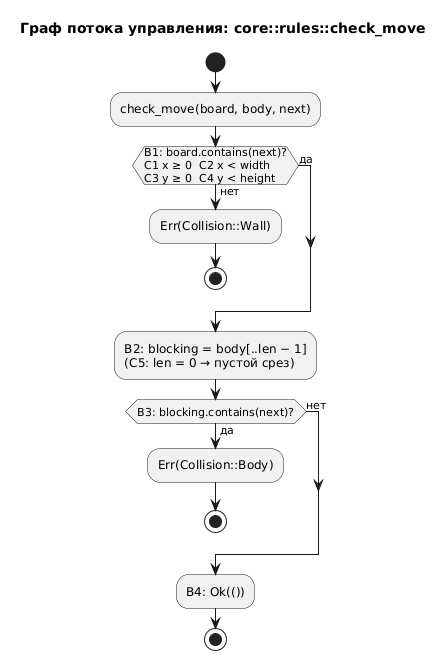

# Лабораторная работа 1. Тестирование чёрного и белого ящика

**Имя студента:** Цароев Альберт Казебкович\
**Группа:** ПИЖ-б-о-23-1(1)\
**Предмет:** Тестирование и отладка программного обеспечения\
**Претендую на оценку:** Отлично

---

## 1. Описание метода и стратегии тестирования

### 1.1. Метод

**Чёрный ящик** - тесты строятся по спецификации, код не рассматривается. Техники: классы эквивалентности,
граничные значения, таблицы решений, диаграммы состояний. Метод проверяет, что программа делает то, что
обещано, но не показывает, какая часть кода осталась непроверенной.

**Белый ящик** (структурное тестирование) - тесты строятся по коду. По функции строится граф потока
управления, затем подбираются входные данные, при которых выполнится каждый элемент графа. Критерии от слабого к сильному:

| Критерий            | Требование                                                                               |
| ------------------- | ---------------------------------------------------------------------------------------- |
| покрытие операторов | каждый оператор выполнен хотя бы раз                                                     |
| покрытие ветвей     | каждое решение (`if`, `match`) принимает каждое своё значение                            |
| покрытие условий    | каждое элементарное условие внутри решения принимает и `true`, и `false`                 |
| покрытие путей      | пройден каждый независимый путь; их число - цикломатическая сложность V(G) = решений + 1 |

**Выбран белый ящик.** Правила игры вынесены в небольшие чистые функции модуля `core`, и в каждой есть
ветвления. По ним легко построить граф и показать, какому тесту соответствует какая ветвь.

### 1.2. Объекты тестирования

| Функция                   | Что делает                      | Решения                                         | V(G) |
| ------------------------- | ------------------------------- | ----------------------------------------------- | ---- |
| `core::rules::check_move` | разрешён ли ход головы в клетку | B1 стена (4 условия C1–C4), B3 тело             | 3    |
| `core::highscore::parse`  | разбор файла рекорда            | B1 пусто/не цифры (2 условия), B2 переполнение  | 3    |
| `SpeedRules::interval`    | интервал хода от счёта          | B1 `every = 0`, B2 насыщение, B3 нижняя граница | 4    |

### 1.3. Стратегия

1. По коду функции построить граф потока управления и пронумеровать решения (B) и условия (C).
2. На каждый исход каждого решения и каждого условия написать тест. Номер ветви - в имени теста (`b1_c3_bottom_wall`).
3. Добавить тесты на границы, которые видны только из кода. Пример: `saturating_sub` в `interval` нужен потому, что без него при большом счёте была бы паника.
4. Проверить сами тесты внесением ошибки (мутацией) в код: правильный набор тестов должен её обнаружить.

### 1.4. Граф потока управления `check_move`



Код:

```rust
pub fn check_move(board: &Board, body: &[Cell], next: Cell) -> Result<(), Collision> {
    if !board.contains(next) {                                // B1 (C1–C4 внутри contains)
        return Err(Collision::Wall);
    }
    let blocking = &body[..body.len().saturating_sub(1)];     // B2, C5: хвост не блокирует
    if blocking.contains(&next) {                             // B3
        return Err(Collision::Body);
    }
    Ok(())                                                    // B4
}
```

Хвост в этот же ход освобождает свою клетку, поэтому въезд в неё разрешён. Из спецификации («нельзя
врезаться в себя») это правило не следует, оно видно только в коде. Тест `b3_false_tail_cell_is_free`
появился именно из анализа кода.

### 1.5. Запуск

```bash
cargo test --test lb1                    # все тесты работы
cargo test --test lb1 -- check_move      # только check_move
scripts/test.sh lb1 --report             # + протокол в labs/lb1/results.txt
```

## 2. Диаграмма классов

Объекты тестирования находятся в пакете `core`: правила игры без зависимостей от Bevy.


## 3. Тестовые материалы

Код тестов: [check_move.rs](check_move.rs), [highscore_parse.rs](highscore_parse.rs), [speed_interval.rs](speed_interval.rs).

### 3.1. `check_move`, поле 5×4

| Тест                           | Ветвь / условие            | Вход: тело → `next`            | Ожидается   |
| ------------------------------ | -------------------------- | ------------------------------ | ----------- |
| `b1_c1_left_wall`              | B1, C1 ложно               | (0,1),(1,1) → (−1,1)           | `Err(Wall)` |
| `b1_c2_right_wall`             | B1, C2 ложно               | (4,1),(3,1) → (5,1)            | `Err(Wall)` |
| `b1_c3_bottom_wall`            | B1, C3 ложно               | (2,0),(2,1) → (2,−1)           | `Err(Wall)` |
| `b1_c4_top_wall`               | B1, C4 ложно               | (2,3),(2,2) → (2,4)            | `Err(Wall)` |
| `b1_false_on_every_corner`     | B1 ложно, C1–C4 на границе | 4 угла поля                    | `Ok`        |
| `b3_true_hits_body`            | B3 истинно                 | кольцо из 5 клеток → (1,0)     | `Err(Body)` |
| `b3_false_tail_cell_is_free`   | B3 ложно (клетка хвоста)   | 4 клетки → клетка хвоста (1,0) | `Ok`        |
| `c5_empty_body_does_not_panic` | C5: `len = 0`              | ∅ → (2,2)                      | `Ok`        |
| `c5_single_segment`            | C5: `len = 1`              | (2,2) → (2,3)                  | `Ok`        |
| `b4_free_cell`                 | B4                         | (2,2),(1,2),(0,2) → (3,2)      | `Ok`        |

### 3.2. `highscore::parse`

| Тест                          | Ветвь / условие                                   | Вход           | Ожидается        |
| ----------------------------- | ------------------------------------------------- | -------------- | ---------------- |
| `b1_c1_empty`                 | C1 истинно                                        | `""`           | `None`           |
| `b1_c1_only_whitespace`       | C1 после `trim`                                   | `" \n\t"`      | `None`           |
| `b1_c2_letters`               | C2 истинно                                        | `"12a"`        | `None`           |
| `b1_c2_minus_sign`            | C2 истинно                                        | `"-3"`         | `None`           |
| `b1_c2_plus_sign_is_rejected` | C2 истинно; стандартный `parse` здесь вернул бы 5 | `"+5"`         | `None`           |
| `b2_err_overflow`             | B2 → `Err`                                        | `"4294967296"` | `None`           |
| `b2_ok_max`                   | B2 → `Ok`, граница                                | `"4294967295"` | `Some(u32::MAX)` |
| `b2_ok_with_newline`          | B2 → `Ok`                                         | `"42\n"`       | `Some(42)`       |

### 3.3. `SpeedRules::interval` (base 150 мс, min 60, step 10, every 5)

| Тест                                 | Ветвь         | Вход                      | Ожидается   |
| ------------------------------------ | ------------- | ------------------------- | ----------- |
| `b1_some_level_grows_every_n_points` | B1 → `Some`   | счёт 4; 5                 | 150; 140 мс |
| `b1_none_every_zero_never_speeds_up` | B1 → `None`   | every = 0, счёт 1000      | 150 мс      |
| `b2_saturates_instead_of_underflow`  | B2 насыщение  | min 0, every 1, счёт 1000 | 0           |
| `b3_clamped_to_min`                  | B3 → min      | счёт 45; 50               | 60; 60 мс   |
| `b3_not_clamped_above_min`           | B3 → разность | счёт 40                   | 70 мс       |

## 4. Результаты выполнения тестов

Все 23 теста пройдены. Протокол: [results.txt](results.txt).

```text
Протокол: lb1
Система:  Linux 7.0.0-38-generic x86_64
Rust:     rustc 1.98.1 (48a229cea 2026-09-01)
Команда:  cargo test --test lb1

test check_move::b1_c1_left_wall ... ok
test check_move::b1_c2_right_wall ... ok
test check_move::b1_c3_bottom_wall ... ok
test check_move::b1_c4_top_wall ... ok
test check_move::b1_false_on_every_corner ... ok
test check_move::b3_false_tail_cell_is_free ... ok
test check_move::b3_true_hits_body ... ok
test check_move::b4_free_cell ... ok
test check_move::c5_empty_body_does_not_panic ... ok
test check_move::c5_single_segment ... ok
test highscore_parse::b1_c1_empty ... ok
test highscore_parse::b1_c1_only_whitespace ... ok
test highscore_parse::b1_c2_letters ... ok
test highscore_parse::b1_c2_minus_sign ... ok
test highscore_parse::b1_c2_plus_sign_is_rejected ... ok
test highscore_parse::b2_err_overflow ... ok
test highscore_parse::b2_ok_max ... ok
test highscore_parse::b2_ok_with_newline ... ok
test speed_interval::b1_none_every_zero_never_speeds_up ... ok
test speed_interval::b1_some_level_grows_every_n_points ... ok
test speed_interval::b2_saturates_instead_of_underflow ... ok
test speed_interval::b3_clamped_to_min ... ok
test speed_interval::b3_not_clamped_above_min ... ok

test result: ok. 23 passed; 0 failed; 0 ignored; 0 measured; 0 filtered out
```

### Проверка тестов мутацией

| Мутация в коде                                    | Результат                                              |
| ------------------------------------------------- | ------------------------------------------------------ |
| `let blocking = body;` (хвост тоже блокирует ход) | упал `b3_false_tail_cell_is_free`, остальные 22 прошли |

Тест упал ровно на той ветви, ради которой был написан.
