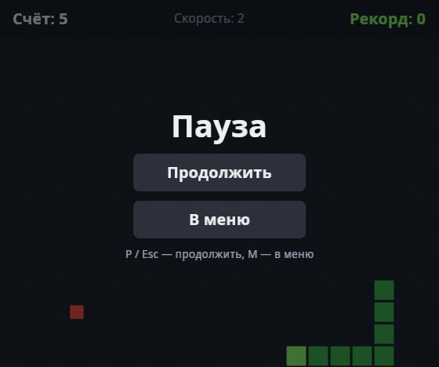

# Лабораторная работа 2. Ручное и автоматизированное тестирование

**Имя студента:** Цароев Альберт Казебкович\
**Группа:** ПИЖ-б-о-23-1(1)\
**Предмет:** Тестирование и отладка программного обеспечения\
**Претендую на оценку:** Отлично

---

## 1. Описание метода и стратегии тестирования

### 1.1. Метод

**Ручное тестирование** - человек выполняет шаги тест-кейса и сам сравнивает результат с ожидаемым.
Ручная проверка хорошо подходит для внешнего вида, удобства и исследовательского тестирования. Её недостатки:
каждый прогон стоит времени, результат зависит от внимательности, а в игре ещё и от реакции (успеть
повернуть за 150 мс).

**Автоматизированное тестирование** - шаги и сравнение выполняет программа. Прогон дешёвый и одинаковый
каждый раз, поэтому его можно запускать после каждого изменения (регрессия). Минусы: нужен код тестов
и способ управлять приложением без человека.

**Выбрано автоматизированное тестирование.** Ручной чек-лист составлен первым: он фиксирует сценарии
так, как их проверяет игрок. Затем каждая строка чек-листа переведена в автотест.

### 1.2. Как игра управляется без человека

Автоматизировать игру с окном и таймером мешают две вещи: ввод идёт от оконной системы, а ход змейки
зависит от реального времени. Обе решаются средствами Bevy, без изменений в коде игры:

| Проблема                | Решение в стенде [`labs/common`](../common/mod.rs)                                                                                           |
| ----------------------- | -------------------------------------------------------------------------------------------------------------------------------------------- |
| нужно окно и видеокарта | `MinimalPlugins` + `SnakeLogicPlugin`: логика работает без окна и рендера                                                                    |
| ввод с клавиатуры       | тест пишет сообщения `KeyboardInput`, те же, что шлёт окно; дальше их обрабатывает штатный `InputPlugin`                                     |
| реальное время          | `TimeUpdateStrategy::ManualDuration`: каждый кадр время сдвигается ровно на заданную величину; `tick()` проматывает время до следующего хода |
| случайная еда           | `ScriptedSpawner` кладёт еду в заданные клетки                                                                                               |

Тест читается как сценарий игрока:

```rust
let mut h = Harness::playing(config(20, 15), [Cell::new(11, 7)]);   // еда в 2 клетках перед головой
h.ticks(2);
assert_eq!(h.score(), 1);
assert_eq!(h.snake().len(), 4);
```

### 1.3. Стратегия

1. Составить ручной чек-лист по основным функциям (раздел 3.1) и один раз пройти его вручную.
2. Для каждой строки написать автотест с тем же номером (`mt5_eating_grows_and_scores` ↔ MT-5).
3. Строки, которые нельзя проверить без экрана (цвета, шрифт), остаются ручными. Их подкрепляют
   снимки экранов, которые делает `cargo run --example screens` с автопилотом.
4. Сравнить затраты на ручной и автоматический прогон.

### 1.4. Запуск

```bash
cargo test --test lb2
scripts/test.sh lb2 --report
cargo run --example screens        # снимки экранов → docs/screens/
```

## 2. Диаграмма классов

Тестовый стенд и его связь с игрой:


Классы игры:


## 3. Тестовые материалы

Код автотестов: [scenarios.rs](scenarios.rs). Стенд: [labs/common/mod.rs](../common/mod.rs).

### 3.1. Ручной чек-лист и соответствие автотестам

Начальное положение: поле 20×15, змейка из 3 клеток, голова в (9,7), движение вправо.

| №     | Шаги                                | Ожидаемый результат                                        | Автотест                             |
| ----- | ----------------------------------- | ---------------------------------------------------------- | ------------------------------------ |
| MT-1  | Запустить игру, нажать Enter        | Меню исчезает, на поле змейка из 3 клеток и еда, счёт 0    | `mt1_enter_starts_round`             |
| MT-2  | Ничего не нажимать                  | Змейка смещается на 1 клетку за ход, между ходами стоит    | `mt2_snake_moves_one_cell_per_tick`  |
| MT-3  | Нажать ↑                            | На следующем ходу змейка идёт вверх                        | `mt3_arrow_turns_snake`              |
| MT-4  | Двигаясь вправо, нажать ←           | Нажатие игнорируется, змейка продолжает вправо             | `mt4_reverse_is_ignored`             |
| MT-5  | Направить змейку на еду             | Счёт +1, змейка длиннее на 1, еда появилась в другом месте | `mt5_eating_grows_and_scores`        |
| MT-6  | Нажать P, подождать, нажать Esc     | На паузе змейка стоит, после - продолжает                  | `mt6_pause_freezes_and_resumes`      |
| MT-7  | Довести змейку до стены             | Экран «Игра окончена», причина «Столкновение со стеной»    | `mt7_wall_ends_round`                |
| MT-8  | На экране конца партии нажать Enter | Новая партия: счёт 0, змейка в начальном положении         | `mt8_enter_restarts_after_game_over` |
| MT-9  | На паузе нажать M                   | Меню, поле пустое                                          | `mt9_menu_from_pause`                |
| MT-10 | Посмотреть на экраны                | Кириллица читается, голова светлее тела, еда красная       | ручная, снимки `docs/screens/`       |
| MT-11 | Навести мышь на кнопку и нажать     | Кнопка подсвечивается, действие выполняется                | ручная                               |

### 3.2. Входные данные

| Тест                        | Конфигурация           | Еда (сценарий)                   |
| --------------------------- | ---------------------- | -------------------------------- |
| MT-1…MT-4, MT-6, MT-7, MT-9 | 20×15, длина 3, вправо | (0,0), вдали от маршрута         |
| MT-5                        | 20×15                  | (11,7), на пути змейки           |
| MT-8                        | 20×15                  | (10,7), съедается на первом ходу |

### 3.3. Сравнение затрат

|               | Ручной прогон MT-1…MT-9                                       | Автоматический                    |
| ------------- | ------------------------------------------------------------- | --------------------------------- |
| Время         | _замерить при ручном прогоне_ (минуты)                        | 0.02 с (см. протокол)             |
| Повторяемость | зависит от реакции: повернуть точно в клетку за 150 мс трудно | одинаковый результат каждый раз   |
| Что видно     | всё на экране, включая внешний вид                            | только то, что проверяет `assert` |

## 4. Результаты выполнения тестов

Все 9 автотестов пройдены. Протокол: [results.txt](results.txt).

```text
Протокол: lb2
Система:  Linux 7.0.0-38-generic x86_64
Rust:     rustc 1.98.1 (48a229cea 2026-09-01)
Команда:  cargo test --test lb2

test scenarios::mt1_enter_starts_round ... ok
test scenarios::mt2_snake_moves_one_cell_per_tick ... ok
test scenarios::mt3_arrow_turns_snake ... ok
test scenarios::mt4_reverse_is_ignored ... ok
test scenarios::mt5_eating_grows_and_scores ... ok
test scenarios::mt6_pause_freezes_and_resumes ... ok
test scenarios::mt7_wall_ends_round ... ok
test scenarios::mt8_enter_restarts_after_game_over ... ok
test scenarios::mt9_menu_from_pause ... ok

test result: ok. 9 passed; 0 failed; 0 ignored; 0 measured; 0 filtered out
```

Ручной прогон MT-10, MT-11: артефактов не наблюдается

| Меню                               | Игра                                  | Пауза                               | Конец партии                            |
| ---------------------------------- | ------------------------------------- | ----------------------------------- | --------------------------------------- |
|  |  |  |  |
