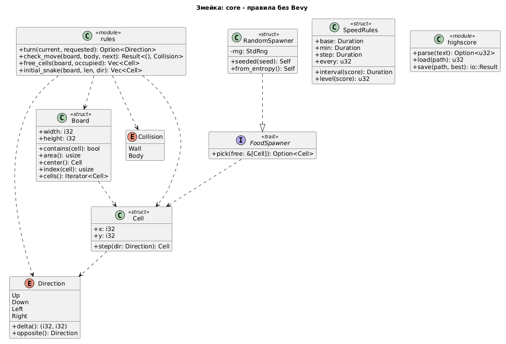
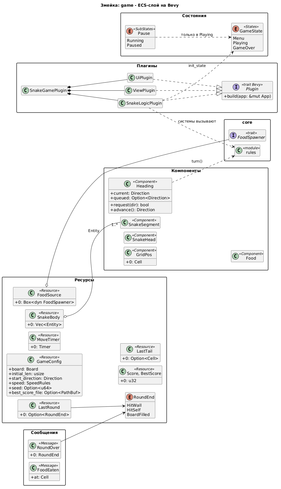

# Лабораторная работа 4. Нефункциональное тестирование

**Имя студента:** Цароев Альберт Казебкович\
**Группа:** ПИЖ-б-о-23-1(1)\
**Предмет:** Тестирование и отладка программного обеспечения\
**Претендую на оценку:** Отлично

---

## 1. Описание метода и стратегии тестирования

### 1.1. Виды нефункционального тестирования

| Вид                    | Вопрос                                 | Применимость к игре                                         |
| ---------------------- | -------------------------------------- | ----------------------------------------------------------- |
| **Производительность** | насколько быстро?                      | **да**: ход должен укладываться в кадр                      |
| **Нагрузочное**        | как ведёт себя при ожидаемой нагрузке? | **да**: длинная змейка, большое поле                        |
| **Стресс**             | где предел?                            | **да**: размер поля, при котором ход не укладывается в кадр |
| Безопасность           | можно ли сломать через входные данные? | частично: файл рекорда (ЛР1, ЛР6)                           |
| Удобство использования | удобно ли игроку?                      | ручная оценка (ЛР2, MT-10/11)                               |
| Совместимость          | работает ли на разных платформах?      | ЛР6                                                         |

**Выбраны производительность, нагрузка и стресс.** Для игры это главное нефункциональное требование:

> **NFR-1.** Ход змейки выполняется быстрее одного кадра при 60 FPS - **16.7 мс**.

### 1.2. Что нагружается

При каждом съедании `spawn_food` вызывает `core::rules::free_cells`: функция обходит всё поле, чтобы найти
свободные клетки. Её сложность O(площадь поля), а не O(длина змейки). Это самое дорогое место хода.

### 1.3. Стратегия и методика замеров

1. **Smoke-проверка бюджета** входит в обычный прогон: средний ход на стандартном поле короче кадра даже в отладочной сборке.
2. **Нагрузка:** время `free_cells` на полях от 20×20 до 1000×1000, змейка занимает половину клеток. Ожидается рост, пропорциональный площади, то есть постоянное время на клетку.
3. **Стресс:** поле удваивается, пока один вызов не превысит 16.7 мс. Последний размер и есть предел.

Правила замеров:

- release-сборка (`--release`): в отладочной сборке замеры показывают скорость отладочного кода;
- `--test-threads=1`: замеры не делят процессор между собой;
- `std::hint::black_box`: компилятор не выбросит вычисление, результат которого не используется;
- среднее по нескольким запускам.

Внешний фреймворк замеров (criterion) не подключён. Каждая новая зависимость может изменить набор фич
общих крейтов workspace, и тогда bevy пересоберётся отдельной копией (см. README.md workspace).
Для этих замеров хватает `std::time::Instant`.

### 1.4. Запуск

```bash
cargo test --test lb4                                         # smoke-проверка бюджета
cargo test --release --test lb4 -- --ignored --nocapture --test-threads=1   # замеры
scripts/test.sh lb4 --perf --report                           # замеры → labs/lb4/results_perf.txt
```

## 2. Диаграмма классов

Объект замеров - `rules::free_cells` и цепочка систем хода (`SnakeLogicPlugin`).





## 3. Тестовые материалы

Код: [performance.rs](performance.rs).

| Тест                                      | Вид                        | Входные данные                                          | Критерий                           |
| ----------------------------------------- | -------------------------- | ------------------------------------------------------- | ---------------------------------- |
| `tick_fits_frame_budget_on_default_board` | производительность (smoke) | поле 20×15, 9 ходов, каждый со съеданием                | среднее < 16.7 мс                  |
| `free_cells_scaling`                      | нагрузка                   | поля 20² … 1000², занята каждая 2-я клетка, 20 запусков | нс/клетку не растёт                |
| `free_cells_frame_limit`                  | стресс                     | поле 100², 200², 400²…                                  | первый размер с временем > 16.7 мс |

## 4. Результаты выполнения тестов

### 4.1. Обычный прогон

```text
Команда:  cargo test --test lb4

test performance::free_cells_frame_limit ... ignored, замер: запускать в --release с --ignored --nocapture
test performance::free_cells_scaling ... ignored, замер: запускать в --release с --ignored --nocapture
test performance::tick_fits_frame_budget_on_default_board ... ok

test result: ok. 1 passed; 0 failed; 2 ignored; 0 measured; 0 filtered out
```

### 4.2. Замеры

Окружение: Intel Core i7-12700H (20 логических ядер, L2 11.5 МиБ, L3 24 МиБ), Ubuntu 26.04, Linux 7.0.0-38, rustc 1.98.1.

**Release-сборка** (основной результат). Протокол: [results_perf.txt](results_perf.txt).

```text
Команда:  cargo test --release --test lb4 -- --ignored --nocapture --test-threads=1

       поле     клеток   free_cells    нс/клетку
      20×20        400      1.220µs         3.05
      50×50       2500      5.995µs         2.40
    100×100      10000     19.261µs         1.93
    200×200      40000     52.975µs         1.32
    500×500     250000    321.553µs         1.29
  1000×1000    1000000      1.352ms         1.35

100×100: 23.441µs
200×200: 101.11µs
400×400: 391.603µs
800×800: 967.52µs
1600×1600: 4.52016ms
3200×3200: 28.616896ms
предел: поле 3200×3200 (10240000 клеток)

test result: ok. 2 passed; 0 failed; 0 ignored; 0 measured; 1 filtered out
```

Для сравнения - тот же прогон в **dev-профиле** (`opt-level = 1`, без `--release`):

```text
       поле     клеток   free_cells    нс/клетку
      20×20        400      1.311µs         3.28
      50×50       2500      6.321µs         2.53
    100×100      10000     25.067µs         2.51
    200×200      40000     99.028µs         2.48
    500×500     250000    662.425µs         2.65
  1000×1000    1000000      2.663ms         2.66

100×100: 52.466µs
200×200: 217.796µs
400×400: 800.446µs
800×800: 1.903217ms
1600×1600: 7.637015ms
3200×3200: 39.349611ms
предел: поле 3200×3200 (10240000 клеток)
```

| Поле | dev | release | Ускорение |
|---|---|---|---|
| 200×200 | 99.0 мкс | 53.0 мкс | 1.9× |
| 1000×1000 | 2.66 мс | 1.35 мс | 2.0× |
| 3200×3200 | 39.3 мс | 28.6 мс | 1.4× |

### 4.3. Выводы

- **NFR-1 выполнено.** На игровом поле 20×15 (300 клеток) вызов `free_cells` занимает около 1 мкс. Это примерно в 10 000 раз меньше бюджета кадра 16.7 мс.
- **Линейность подтверждается на средних полях.** От 200×200 до 1000×1000 время на клетку постоянно (1.3 нс), то есть время растёт пропорционально площади.
- **На малых полях время на клетку выше** (3 нс на 20×20). Кроме обхода клеток, у каждого вызова есть постоянная цена: выделение двух векторов. На маленьком поле она заметна, на большом теряется.
- **На очень больших полях рост становится быстрее линейного.** С 1600² на 3200² клеток в 4 раза больше, а время выросло в 6.3 раза (2.8 нс на клетку). Вероятная причина - кэш процессора. Функция работает с таблицей занятости (1 байт на клетку) и списком свободных клеток (8 байт на клетку, свободна половина). На 1600² это около 13 МБ, и данные помещаются в L3 (24 МиБ). На 3200² это около 50 МБ: данные не помещаются, и скорость упирается в оперативную память. Release-сборка здесь даёт меньший выигрыш (1.4× против 2×), что согласуется с этим объяснением: оптимизации кода не ускоряют память.
- **Предел (стресс):** бюджет кадра превышается между полями 1600² (4.5 мс, укладывается) и 3200² (28.6 мс, не укладывается). Для таких полей свободные клетки пришлось бы не пересчитывать при каждом съедании, а хранить постоянно и обновлять на каждом ходу за O(1).
